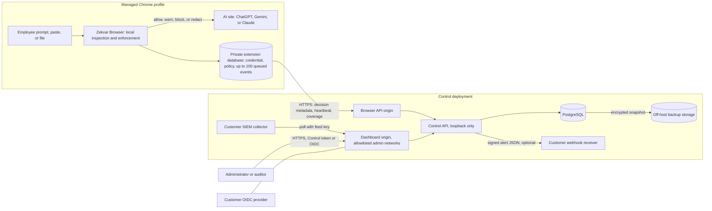

# Security and privacy questionnaire answers

These answers are for customer security reviews (SIG Lite and CAIQ-style topics). They describe what the Zekvar Browser extension and Control do today, based on the product code and operator guides. Items the company has not decided or documented are marked **[TO CONFIRM]**. Do not treat a [TO CONFIRM] item as a commitment.

Product status: Browser v0.40.0 and Control are in design-partner pilot preparation. Hosted production is not yet launched. See the [release readiness checkpoint](../product_plan.md#release-readiness-checkpoint).

## Summary

- The extension evaluates prompts, pasted text, and files in the browser. Prompt text, file contents, file names, and matched values are not sent to Control.
- Control receives decision metadata: which app, when, which detector category, which policy version, and the action taken.
- Control is tenant-scoped by organization. Access is named, role-based, and time-limited. Optional OIDC single sign-on is supported.
- The company has not made the following commitments yet: SOC 2 status, hosting provider and region, subprocessors, breach-notification time, penetration-test cadence. See [Open commitments](#open-commitments).

## Data flow

Notes on the diagram:

- The extension makes one kind of network call: to the Control browser API origin it was built for. The worker's only `fetch` call is in [`worker.ts`](../apps/browser-extension/src/worker.ts). The PDF and OCR engines and their language data are bundled, not downloaded.
- The pilot deployment is a single host. Caddy terminates TLS for two hostnames. The administrative API listens on loopback only. See the [TLS pilot README](../deploy/pilot/README.md).

## What is processed locally and what is sent

### Processed on the device only

- Prompt text at Send, and text pasted into a recognized composer (up to 64,000 UTF-16 code units per paste).
- File contents for supported files at attach time: UTF-8 text (256 KiB per file), Word, Excel, PowerPoint, OpenDocument text, spreadsheets and presentations, PDF text (up to 24 pages and 256 KiB), scanned or mixed PDF pages (up to three pages), and PNG and JPEG images read by English OCR.
- Detection of: synthetic test marker, GitHub tokens, payment card numbers (with checksum), private key blocks, possible U.S. Social Security numbers, and organization-defined identifier formats.
- Local redaction for employee review.
- Navigation and AI-site access rules. Visited URLs are not sent to Control.
- The ChatGPT, Gemini, and Claude composer diagnostics text. It stays local until the employee shares it.

Limits are in the [browser README](../apps/browser-extension/README.md#monitor-file-contents).

### Sent to Control

Each decision event contains only these fields (see `PolicyEvent` in [`Contracts.cs`](../apps/control-api/Contracts.cs) and `readMetadata` in [`protocol.ts`](../apps/browser-extension/src/protocol.ts)):

| Field | Meaning |
| --- | --- |
| `eventId` | Random UUID. Control stores one row per installation and event ID, so retries do not duplicate. |
| `appId` | `chatgpt`, `gemini`, `claude`, or the local test fixture. |
| `timestamp` | When the decision happened. |
| `ruleId` and `detectorCategory` | Which detector. Rules: `fixture-secret`, `github-classic-pat`, `github-app-or-fine-grained-token`, `payment-card-number`, `pem-private-key`, `organization-identifier`, `us-social-security-number`, the cloud credential rules (category `credential`), `organization-classification-rule`, the health identifier rules `us-national-provider-identifier`, `dea-registration-number`, `medicare-beneficiary-identifier`, and `medical-record-number` (category `health`), `ai-file-upload`, `file-inspection-unavailable`, `clipboard-inspection-unavailable`. Matched values never leave the browser. |
| `policyVersion`, `assignmentVersion` | Which published policy and rollout assignment applied. |
| `decision` | `monitor`, `warn`, `block`, `warn_override`, or `exception_applied`. |
| `uploadMethod` (optional) | `picker`, `drop`, or `paste` for file attempts. |
| `clipboardPaste` (optional) | `true` for pasted text. |

Control rejects clipboard evidence that includes inspected text and checks each decision against the policy version delivered to that browser ([Control API README](../apps/control-api/README.md#security-event-history-and-export)). The shared example in [`contracts/control/demo-v1.json`](../contracts/control/demo-v1.json) shows the minimal form of this event.

Other data the extension sends:

| Data | When | Contents |
| --- | --- | --- |
| Enrollment | Once per profile | The single-use grant. Control returns an installation ID and a token. |
| Policy fetch and heartbeat | About every 30 seconds while the browser runs | The installation token, the applied policy version, "applied" flags for each capability, the extension manifest version (`X-Zekvar-Extension-Version`), and composer coverage as `ready` or `unsupported` with a check time, per supported app. |
| App observations | Only if app discovery is on and the employee granted the optional `webNavigation` permission | App ID, observation time, policy and assignment version. No URLs or page content. |
| SaaS app inventory | Only if SaaS app inventory is on and the employee granted the optional `webNavigation` permission | Bundled catalog app ID, UTC day, policy and assignment version, at most once per app per day. No URLs, paths, queries, or page titles. |
| Extension inventory | Only if turned on and the employee granted the optional `management` permission | Per installed extension: ID, name, version, enabled, install type, site access category (`none`, `selected`, `all`), and a subset of API permissions. Not host patterns, descriptions, or links. Up to 100 entries. |
| Policy review request | Only if the employee selects it | An event ID and app ID. |

Network metadata the servers see unavoidably: the source IP address and TLS details. The shipped [Caddyfile](../deploy/pilot/Caddyfile) keeps access logs off. Caddy's error entries, such as an unreachable upstream, include the client IP, method, host, and path. Its log filter removes query strings and the `Authorization`, `Proxy-Authorization`, `Cookie`, and `Set-Cookie` headers. The Control API does not log requests. [TO CONFIRM: production log retention and IP address handling in Caddy error entries.]

### What Control stores

| Dataset | Contents | Retention control |
| --- | --- | --- |
| Security events | The event fields above, plus installation ID, receipt time, recorded rollout group, and optional triage (status, assignee, disposition). | Yes, `securityEventDays` |
| AI observations | App ID, last observed time per browser and app. | Yes, `aiObservationDays` |
| SaaS app inventory | Catalog app ID with first and last seen UTC day per browser, and the organization's classification per app. | Yes, `aiObservationDays`. Recovery deletes the per-browser records. |
| Audit log | Actor category or named credential (ID, name, role), action, and subject. No credential values, hashes, prompts, grant values, or policy content. | Yes, `auditDays` |
| Incident cases and alerts | Case category, status, linked event references, and alert windows and counts. Resolved cases follow the audit window. | Via the audit and event windows |
| Policies and groups | Versioned policy settings: modes, domain and path rules, blocked AI hosts, custom app catalog, identifier and medical record number formats (prefix and digit count), temporary exceptions with reasons. | No window. Versions are retained. |
| Installations | Installation ID, enrollment and last-seen time, applied policy version, group, extension version, and composer coverage. | No window. See below. |
| Extension inventory snapshots | Latest snapshot per browser and change history of up to 20 reports from the last 30 days. | Scheduled cleanup after 30 days or when the policy turns inventory off. Deleted on revocation. |
| Credentials | SHA-256 hashes of tokens. Raw values are shown once at issue. | Revocation clears the hash. |

Policy exceptions and the organization identifier prefixes are configuration. They are chosen by the customer administrator. Do not put sensitive values in exception reasons or identifier prefixes.

## Encryption

| Topic | Answer |
| --- | --- |
| In transit, browser to Control | HTTPS only. The hosted extension build accepts only an HTTPS origin and declares only that origin as a host permission. |
| In transit, administrators | HTTPS through Caddy with automatic certificates. Response headers include HSTS (`max-age=31536000`), `X-Content-Type-Options: nosniff`, `Referrer-Policy: no-referrer`, `X-Frame-Options: DENY`, and `Cache-Control: no-store`. [TO CONFIRM: minimum TLS version and cipher policy for production.] |
| In transit, internal | The API and dashboard listen on loopback inside the edge network namespace. PostgreSQL sits on a private internal Docker network. |
| In transit, webhooks and SIEM | Webhook delivery requires an HTTPS endpoint (loopback HTTP is allowed in development). Each payload is signed with HMAC-SHA256. The SIEM feed is served over the dashboard's HTTPS origin. |
| At rest, database | Two layers. (1) Volume: the pilot requires the PostgreSQL Docker volume on an encrypted disk. `deploy/pilot/storage-preflight.sh` passes only when the volume's block device has a dm-crypt (LUKS) layer, or records an explicit attestation for cloud provider disk encryption, which the host cannot observe. (2) Application: Control seals organization classification terms, organization identifier formats, and policy review snapshots with AES-256-GCM under a data key from `ZEKVAR_DATA_KEYS`, bound to the organization and field. Existing rows are sealed in place at startup, and a new first key re-seals all values for rotation. The hosted pilot refuses to start without a data key. Webhook signing secrets, OIDC client secrets, and the exchange token are not stored in the database; they stay in the root-only environment file. Bearer credentials are stored only as SHA-256 hashes. [TO CONFIRM: production key custody (who holds the data keys and LUKS passphrase or KMS key), rotation schedule, and the hosting provider's disk encryption.] |
| At rest, backups | Snapshots are encrypted with `age` before they leave the host, checksummed, and published without overwriting existing files. The recovery identity is kept apart from the host and the backup storage. See [Back up and recover Control](../deploy/pilot/README.md#back-up-and-recover-control). |
| At rest, device | The extension keeps enrollment, applied policy, and its event queue in a private browser database. It restricts its Chrome storage to trusted extension contexts. |
| Credential storage | Tokens are 256-bit random values stored as SHA-256 hashes. Control sessions from OIDC are capped at one hour. |

## Tenant isolation

- Policies, installations, audit entries, events, and exports are scoped to an organization. Each Control credential and installation token resolves to one organization.
- Isolation is enforced in the application and its database queries. The migrations contain no PostgreSQL row-level security. [TO CONFIRM: whether row-level security or per-tenant databases are required for the hosted launch.]
- Automated checks cover cross-tenant access for installations, events, exports, rollout groups, cases, alerts, webhooks, and feed keys. Examples are in [`control.test.mjs`](../apps/control-api/test/control.test.mjs): "another tenant cannot read or revoke this installation", "streams retained event metadata ... with isolated, expiring keys", and others.
- The pilot deployment serves one organization on one host. Multi-organization hosting and SSO per organization are implemented but only verified in the lab. MSP delegated administration across client tenants is a later milestone and is not offered.
- The product plan lists a cross-tenant data exposure as a release blocker. See the [support and incident runbook](support-and-incident-response.md#blocker-1-cross-tenant-data-exposure).

## Access control

Roles (see [Named Control access](../apps/control-api/README.md#named-control-access)):

| Role | What it can do |
| --- | --- |
| Owner | The organization credential configured at deployment. Issues and revokes delegated credentials, event feed keys, and SSO identities. Can do everything an administrator can. |
| Administrator | Changes policy, enrollment, app classification, and retention. Triages events and cases. |
| Auditor | Reads and exports the same retained records. Can run policy preview. Cannot change policy. |

- Delegated credentials are named, last 1 to 720 hours, and can be revoked at any time. The next request is rejected, including from an open dashboard session.
- Invalid, expired, or revoked credentials get HTTP 401. A request outside the role gets HTTP 403.
- Optional OpenID Connect sign-in: authorization code flow with PKCE (S256), RS256-signed ID tokens, an exact HTTPS callback. The owner assigns a role to an exact issuer and subject. Control checks organization, provider, expiry, and revocation on every request. The identity provider sets MFA and sign-in rules. Setup is in [Configure Control single sign-on](../deploy/pilot/README.md#configure-control-single-sign-on). Customer identity providers have not yet been verified.
- The owner token remains for recovery. Keep it in a secrets store.
- Optional two-person review: an owner can require a second named administrator to approve policy changes ([Require policy reviews](../apps/control-web/README.md#require-policy-reviews)).
- Network restriction: in the pilot deployment the dashboard accepts connections only from configured administrator networks.
- Event feed keys: read-only, per collector, 1 to 90 days, up to 20 active per organization.
- Enrollment grants: single-use, 10 minutes, one to 25 per batch.
- Enrollment keys for device groups: shown once and stored as a SHA-256 hash, 1 to 30 days, an optional limit of 1 to 100,000 browsers, scoped to the baseline or one rollout group, up to 20 active per organization, and revocable. A key can only create installations. Its format never passes API authentication. Each redemption creates a separate installation with its own credential. Control rate-limits attempts per key and counts rejected attempts. A leaked key lets someone enroll browsers into the key's group until it expires, reaches its limit, or is revoked. Administrators can list and revoke every browser a key enrolled.
- Access review: the owner and auditors see every credential with role, SSO subject, last use, expiry, and creator, with stale credentials flagged after a configurable number of unused days. The owner records a dated review with reviewer name and notes. The record is tied to the exact credential set and appears in the audit log and evidence pack.
- Compliance evidence: owners and auditors can download a dated, metadata-only JSON evidence pack with policy version history, review and rollout approvals, access reviews, retention settings, recorded backup and restore drills, and audit counts.
- Zekvar staff access to customer deployments. [TO CONFIRM: who can access production data, how access is approved, and how often Zekvar staff access is reviewed.]
- Zekvar staff MFA, background checks, and security training. [TO CONFIRM]

## Audit logging

Control records audit entries in the same transaction as the change. Actions include policy publish and restore, grant issue and batch issue and cancel, browser enrollment and revocation, access issue and revoke, SSO sign-ins, retention changes and cleanup counts, event triage, incident case changes, alert settings and acknowledgment, event feed key changes, fleet batches, and policy templates. The full list is in the [audit log section](../apps/control-api/README.md#audit-log).

Control also records data access. Each export of events, incident cases, the audit log, reports, and the evidence pack creates one entry with the actor, filters, and record count. Views of reports, browser extensions, and the access review are summarized per actor, resource, and UTC hour. SIEM feed reads are summarized per key and hour with request and record counts. Access entries never contain exported records. They follow the audit retention window.

Administrators and auditors can filter changes and data access and export up to 1,000 entries per file ([Review and export the audit log](../apps/control-web/README.md#review-and-export-the-audit-log)). Export of audit records to a customer SIEM is not provided. The security event feed carries decision metadata only.

Application logs: the Control API writes JSON lines to stdout for the systemd journal or `docker logs`. Framework, HTTP client, and database driver logs are limited to Warning and above, and configuration cannot lower that limit. The API therefore logs no request URLs, query strings, headers, or bodies, and no SQL parameters. Background jobs log the error type only. Unhandled request errors log the exception type, SQL state, route template, trace ID, and stack frames, but not the message. A regression test sends synthetic admin tokens, enrollment grants, browser tokens, feed keys, classification terms, prompt text, query strings, cookies, and malformed bodies. It asserts that none of them appear in the API output ([logging](../apps/control-api/README.md#logging)). [TO CONFIRM: review a log sample from the staging host and set production log retention.]

## Retention and deletion

- Retention windows are per organization for security events, AI observations, and audit history. Values are whole days from 1 to 3,650, or no expiry. A new organization starts with no expiry.
- Expired records are hidden immediately and deleted in batches. Control sweeps at startup and hourly by default. An administrator can run cleanup on demand (up to 1,000 rows per dataset per run).
- Shortening a window deletes data permanently. Widening cannot revive it.
- Revoking a browser deletes its extension inventory snapshots and composer observations.
- Administrators can permanently delete a revoked browser and every record derived from it. The audit log keeps a tombstone with the browser ID and the deleted counts only.
- Administrators can purge superseded policy versions before a cutoff. Current versions and versions still used by an open review, an unfinished rollout, a retained event, a browser, or retained evidence stay.
- Organization deletion (GDPR erasure and offboarding): the owner confirms by typing the organization name. A grace period (7 days by default) suspends every credential, SSO session, browser, event feed key, and webhook at once and can be cancelled by the owner. Control then deletes every tenant row in batches, verifies a zero row count in every table that has an organization column, and keeps an HMAC-signed receipt with per-table counts. The operator can reproduce and verify the receipt. Only the deletion ID, organization ID, hashes used to block an accidental re-creation, and the receipt remain.
- Data return (portability): the owner can download a streaming JSON export of all retained tenant data at any time, including during the grace period.
- Deleted data persists in encrypted backups until they age out. The pilot default is 35 days (`ZEKVAR_BACKUP_RETENTION_DAYS`), applied by the local prune command and the S3 lifecycle rule. Receipts state the configured period. Restoring an older backup brings deleted data back, so operators reapply recorded deletions before exposing a restored environment.
- Everything is role-limited and audited: owners alone export and delete the organization, administrators delete browser data and purge policy history, and auditors read only.
- How to delete: see [Delete retained Control data](install-and-remove.md#delete-retained-control-data) and [Export and delete the whole organization](install-and-remove.md#export-and-delete-the-whole-organization).

## Backup and recovery

- Operators take encrypted PostgreSQL snapshots, daily at 02:00 UTC with a systemd timer, plus an independent freshness check on the off-host bucket. See [Schedule off-host backups](../deploy/pilot/README.md#schedule-off-host-backups).
- Restore revokes previous browser enrollments, named credentials including SSO identities, and event feed keys. It clears extension inventory snapshots, expires unused grants, cancels pending reviews and webhook jobs, and changes the feed generation. Customers re-enroll browsers and reissue credentials after a restore.
- A disposable-environment drill was run for local and loopback S3 storage. A timed restore on a real staging deployment is outstanding.
- Backup retention is configurable and defaults to 35 days in the pilot kit. Recovery time objective, recovery point objective, and disaster recovery site. [TO CONFIRM]
- Behavior when Control is unreachable: the extension keeps enforcing the last saved policy and queues up to 100 metadata events. If the queue fills, it discards the oldest event and shows the discard count in the popup.

## Browser extension permissions

From [`manifest.json`](../apps/browser-extension/manifest.json) (v0.40.0). The hosted build replaces the development host permission with your Control origin only.

| Permission | Why it is needed |
| --- | --- |
| `storage` | Reads the `EnrollmentGrant`, `EnrollmentKey`, and `ControlOrigin` values your device manager supplies, and holds extension state. The extension keeps a random per-profile enrollment nonce and a hash of keys it has used, not the key itself. |
| `alarms` | Schedules the periodic policy sync and heartbeat, every 30 seconds. |
| `declarativeNetRequest` | Applies your navigation rules and AI-site blocks to top-level HTTP and HTTPS requests. Rules are evaluated by Chrome. Visited URLs are not sent to Control. |
| `offscreen` | Runs the bundled PDF and image text engines in a hidden extension page. |
| Host permission: your Control origin | Lets the extension call the Control browser API. |
| Content scripts on `chatgpt.com`, `gemini.google.com`, `claude.ai` | Recognize the composer and Send control and hold a submission while it is checked. A discovery script on the same three sites reports a visit when app discovery is on. |
| Optional `management` | Only for extension inventory. The employee must approve a Chrome prompt in the popup. |
| Optional `webNavigation` | Only for discovery of preset and custom apps and for SaaS app inventory. The employee must approve a Chrome prompt. Top-level committed HTTPS pages on cataloged hosts only. |

Extension page content security policy: `script-src 'self' 'wasm-unsafe-eval'; object-src 'self'; worker-src 'self'`, plus `connect-src` limited to `'self'` and your Control origin. `wasm-unsafe-eval` is needed for the bundled OCR engine.

Coverage limits are documented in the [browser README](../apps/browser-extension/README.md). Live signed-in coverage for ChatGPT, Gemini, and Claude is not yet verified. See the coverage matrix. [Coverage (app-by-action matrix): forthcoming.]

## Third-party components

Browser extension (bundled):

| Component | Version | License | Use |
| --- | --- | --- | --- |
| pdfjs-dist (PDF.js) | 6.5.438 | Apache-2.0 | PDF text and page rendering |
| tesseract.js | 7.0.0 | Apache-2.0 | Image text recognition worker |
| tesseract.js-core | 7.0.0 | Apache-2.0 | OCR WebAssembly engine |
| @tesseract.js-data/eng (English trained data, `4.0.0_best_int`) | 1.0.0 | Package MIT. Trained data Apache-2.0 per the bundled notice. | English OCR language data |

The build copies the license files and a notice into the package (`pdf-assets/LICENSE`, `ocr-assets/TESSERACT-LICENSE`, `CORE-LICENSE`, `NOTICE`). The tesseract.js worker bundle may contain its own small dependencies (for example idb-keyval, wasm-feature-detect, zlibjs, bmp-js). [TO CONFIRM: complete bundled-notice review before launch.]

Control (server side):

| Component | Version | License |
| --- | --- | --- |
| Npgsql (.NET PostgreSQL driver) | 10.0.3 | PostgreSQL |
| Next.js | 16.4.6 | MIT |
| React and React DOM | 19.3.1 | MIT |
| openid-client | 6.9.1 | MIT |

Runtime images in the pilot kit: `caddy:2-alpine`, `postgres:18`, and the .NET 10 and Node images used by the Dockerfiles.

No customer data is sent to an AI model provider by the extension or Control. The code has no calls to AI provider APIs. The extension's only network destination is your Control origin. Control may call: your OIDC provider (if enabled), your webhook endpoint (if set), and the ACME certificate authority used by Caddy.

Subprocessors and hosting provider. [TO CONFIRM]

## Vulnerability management

What exists today:

- The Control API restores dependencies in locked mode (`packages.lock.json`) and the extension and dashboard have `package-lock.json` files.
- Releases of the extension are signed with a key held on a restricted signing machine. Clients accept updates only from the pinned extension ID.
- Automated suites cover browser enforcement, API, dashboard, signed distribution, rollback, and recovery.
- `node scripts/release-checks.mjs` fails a release when any `package.json` dependency or NuGet package reference uses a version range. It writes CycloneDX 1.5 SBOMs for the extension, dashboard, and API from the lockfiles without network access, and runs `npm audit --omit=dev` and `dotnet list package --vulnerable` when the registries are reachable. High and critical findings fail the check. An offline run reports the audit as skipped.

Not yet documented. [TO CONFIRM]:

- Vulnerability disclosure contact and policy.
- Container image scanning, scheduled dependency scanning between releases, and patch timelines by severity.
- Penetration testing: scope, cadence, date of last test, and whether reports are shareable.
- Secure development lifecycle, code review rules, and how customers request the SBOM.

## Incident notification

The internal runbook, severity levels, and drill scripts are in [support-and-incident-response.md](support-and-incident-response.md). Commitments to customers are not yet set:

- Time to notify a customer of a confirmed security incident or breach. [TO CONFIRM]
- Contact method for incident notices. [TO CONFIRM]
- Regulatory notice roles (controller and processor) and DPA terms. [TO CONFIRM]

## Compliance and legal

The plan has a [compliance roadmap](../product_plan.md#compliance-roadmap). Today:

| Item | Status |
| --- | --- |
| SOC 2 | Not started as an audit. No Type I or Type II report exists. Product evidence is in place: data access logging, owner access reviews, recorded backup and restore drills, an evidence pack, application encryption of confidential configuration, and release SBOMs and dependency audits. [TO CONFIRM: CPA firm, criteria, examination period, and target dates.] |
| ISO/IEC 27001 | Evaluated when procurement demand justifies it. No certificate. |
| HIPAA | Not enabled for ePHI workloads. No business associate agreement is available. [TO CONFIRM] |
| GDPR and regional privacy | Data mapping and DPA are planned. [TO CONFIRM: roles, transfer mechanisms, DPA, data subject request process.] |
| PCI DSS | Browser detects card numbers on the device only and does not send them. Billing scope is separate. [TO CONFIRM] |
| Data residency and hosting region | [TO CONFIRM] |
| Cyber insurance | [TO CONFIRM] |
| Business continuity plan | [TO CONFIRM] |

Employee privacy: Control records metadata of AI decisions per browser installation. Installation IDs, rollout group names, and event timelines are organization data. Customers decide notice to their employees and the retention windows. Control does not record prompt text, file names, file contents, matched values, or visited URLs.

## Open commitments

All [TO CONFIRM] items from this document:

1. Whether Zekvar or the customer hosts Control and the extension update channel.
2. Hosting provider, region, and data residency.
3. Subprocessors.
4. Production key custody and rotation schedule for database volume encryption and application data keys.
5. Minimum TLS version and cipher policy.
6. Production log retention, IP address handling in Caddy error entries, and a staging log sample review.
7. Whether row-level security or stronger tenant separation is required at launch.
8. Zekvar staff access controls, MFA, background checks, and training.
9. Process and timeline for deleting installation records, policy history, and a whole organization, including backups.
10. Backup retention, RTO and RPO, and disaster recovery site.
11. Complete review of bundled third-party notices.
12. Vulnerability disclosure policy, scanning and patch timelines, penetration-test scope, cadence, and last-test date, SDLC. (Release builds generate CycloneDX SBOMs and run dependency audits with `scripts/release-checks.mjs`.)
13. Breach and incident notification time and contact method.
14. SOC 2 and ISO 27001 status and dates.
15. HIPAA and business associate agreement position.
16. GDPR roles, DPA, and data subject request process.
17. Cyber insurance and business continuity plan.
